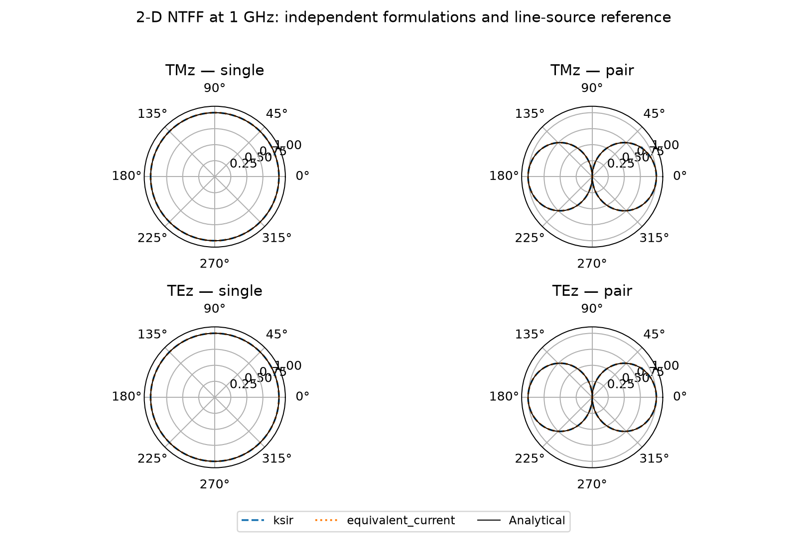
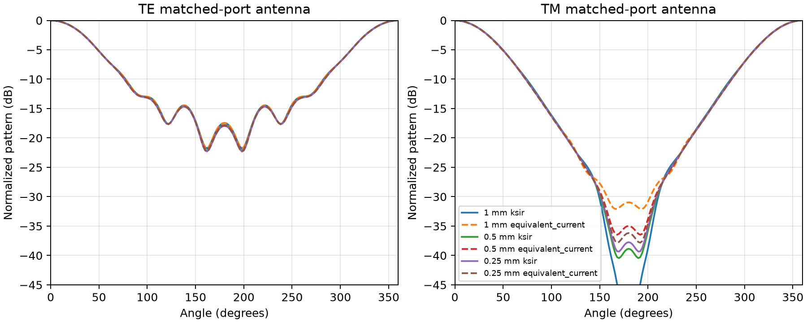

2-D NTFF analytical validation
==============================

The production ``NTFFContour`` implements independent scalar Ramahi/KSIR
and conventional Love-current integrals for every TE/TM invariant axis.
The analytical reference uses outgoing cylindrical line-source fields and
the actual impressed-current spectrum, with no fitted amplitude or phase.

Reproduce the 24 CPU simulations in a new directory:

.. code-block:: console

    python -m testing.validation.ntff_2d.validate_contour --output new_validation

The cases cover single sources and opposite-phase source pairs, all six
TE/TM orientations, 0.8/1.0/1.2 GHz, and 4/2 mm meshes. Each simulation
records both formulations. The driver rejects errors above 2%; measured
errors are substantially smaller. The output directory must be new, so a
rerun cannot overwrite earlier results.

Verified results
----------------

``results/final_cpu/manifest.json`` records the completed runs, source
hashes and frequency-resolved errors. ``verification.json`` also records
hardware parity and regression results. The final CPU results are:

.. list-table:: Worst complex-field error, divided by the analytical angular peak
    :header-rows: 1

    * - Mesh
      - Ramahi/KSIR
      - Equivalent currents
    * - 4 mm
      - 0.1199%
      - 0.1210%
    * - 2 mm
      - 0.0289%
      - 0.0299%

The separate Hankel-field unit tests use a non-vacuum background and check
complex amplitude/phase, second-order convergence, per-length power, and
field orientation. Exterior-source cancellation is also tested.

CUDA and OpenCL were run on an NVIDIA GeForce RTX 4070 Laptop GPU. All 48
parity cases passed across both precisions, both methods and all six modes.
The largest peak-relative difference from CPU was 2.56e-6 in single precision
and 3.97e-15 in double precision. Six MPI tests each compared serial output
with two-rank decompositions along both in-plane axes. All passed. Metal
uses the same device collection interface and has executable parity tests;
hardware tests were skipped on this Windows host.

The broader affected-code regression suite passed 163 tests; three existing
CUDA DFT-convergence tests were skipped because that shell lacked MSVC.
A final contour/MPI rerun passed 43 tests. CUDA contour parity itself was
verified in a configured MSVC shell. Both NumPy and compiled 3-D NTFF
regressions are covered by the existing collector/evaluator tests.

Run the tests with:

.. code-block:: console

    python -m pytest tests/ntff/test_contour.py tests/ntff/test_contour_mpi.py
    python -m pytest tests/ntff/test_contour_accelerators.py

Raw HDF5 simulation outputs remain local. Earlier ``results/cpu`` records a
rejected setup whose coarse contour touched PML; ``results/cpu_verified``
predates final formatting. ``results/final_cpu`` is the final reproducible
reference, and its manifest identifies the exact implementation used.

Matched-port antenna extension
------------------------------

The additional workflow uses finite PEC parallel-plate antennas, enclosed
eigenmode apertures, and auxiliary matched waveguides on CPU and CUDA. Run:

.. code-block:: console

    python -m pytest tests/ntff/test_contour_ports.py tests/ntff/test_contour_modal_power.py
    python -m testing.validation.ntff_2d.validate_matched_antenna --backend cuda --output new_results
    python -m gprMax examples/features/ntff_2d/matched_tmz.in -gpu
    python -m gprMax examples/features/ntff_2d/matched_tez.in -gpu

``results/matched_final`` contains the final independent CUDA
validation, with source hashes, a 20-row manifest, raw fields and modal
spectra, and a pattern-refinement plot. PML and auxiliary-guide physical
lengths remain fixed through refinement. Earlier ``matched_cuda`` and
``matched_cuda_final`` retain rejected coarse-grid setups; the successful
``matched_cuda_verified`` study used fixed cell counts for the termination
and is superseded for refinement comparisons. ``matched_cuda_converged``
predates the full complex-impedance net-flux expression; its lossless results
agree with the final run. The original ``final_cpu``
results above remain the contour-only validation baseline.

Analytical references are separate from the finite-antenna conservation
test. A uniform, lossless parallel-plate guide has zero reflection and
unit-power modal normalization. With a unit Ricker pulse at f0, its exact
Fourier amplitude magnitude at f0 is ``2 exp(-1)/(sqrt(pi) f0)``. The
accepted spectral power per length is its square. Across both propagation
axes, both directions, and all six reduced modes, the largest measured
reflection amplitude was 0.001573 (about -56 dB) and the largest error in
accepted power was 0.211%. No field-amplitude fitting is used. The CUDA
line-source and opposite-phase-pair solutions independently check complex
far-field amplitude, phase, and angular pattern against outgoing Hankel
Green functions; their largest peak-relative error was 0.02991%.

The finite open-ended antenna does not have a closed-form pattern. Its
validation compares both contour formulations, CPU/CUDA fields, accepted
port power against radiated power, and three meshes. At 0.5 mm, the largest
incident-power error against the analytic pulse spectrum was 0.0346%, and
the worst radiation/accepted-power mismatch was 1.359%. At 0.25 mm, the
worst power mismatch was 0.756%. Individual method errors need not decrease
monotonically because field dispersion, finite records, PML reflection,
and contour quadrature contribute differently. Efficiency is not clipped
at one. Antenna S11 is nonzero, as expected for an open radiating load;
the auxiliary guide supplies a matched feed termination.

The final test matrix passed 48 cases and produced 96 CPU/CUDA HDF5 files.
All modal power masks and contour gain masks were valid, and all far fields
were finite. The maximum CUDA/CPU complex-field difference divided by the
CPU angular peak was 7.17e-7 in single precision and 2.21e-15 in double
precision. Both methods are evaluated in each antenna solve. Separate
tests passed 48 analytical/modal cases (including observer invariance and
forward/backward interference for complex modal impedances),
132 CPU virtual-guide regressions, and 11 existing 3-D CUDA regressions.
Both hash-command examples also completed on CUDA. Summary measurements
are saved in ``results/matched_final/verification.json``.

